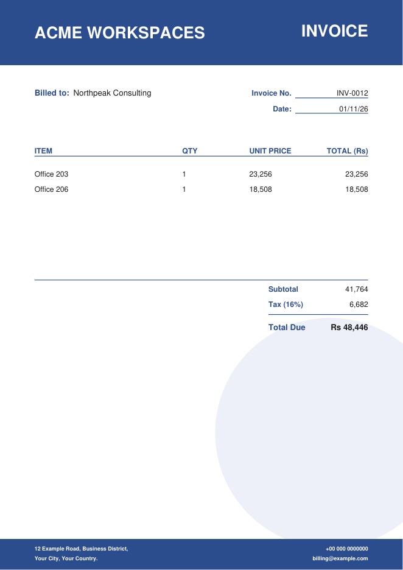

# Monthly Invoice Automation

Turns a simple client spreadsheet into a full month of branded, tax-correct invoice PDFs with one command.

Built for a coworking business that bills every client with **two invoices a month**: an untaxed one (rent) and a taxed one (services, at 16%). Clients are quoted one all-in monthly price, so each amount has to be split back into both invoices, with the right tax, adding up to exactly what the client was quoted, every month, for every client.

**Built with:** Python · reportlab (PDF) · openpyxl (Excel) · unittest

---

## The problem

Doing this by hand every month:

- **Takes hours:** 2 invoices × every client, each with its own number and date.
- **Is error-prone:** splitting an all-in price into a base amount and tax by hand creates 1-rupee mismatches, which clients notice.
- **Has special cases:** clients renting several offices, flat fees that must never carry tax, and clients billed on different days of the month.

## What this does

| | |
|---|---|
| 📄 **Generates every invoice in one run** | Two branded PDFs per client, named and numbered automatically |
| 🧮 **Exact tax math** | Each all-in amount is split into untaxed + taxed + tax, and always sums back to the quoted price to the last rupee (tested on 10,000 random amounts) |
| 🏢 **Multi-office clients** | All of a client's offices land on one combined invoice pair, with one line per office |
| 🚫 **Untaxed fees** | Mark a line `Untaxed Only` (e.g. a static IP fee) and it goes on the untaxed invoice with no tax |
| 📅 **Per-client billing days** | Each client's invoices are dated on their own billing day; `--day 14` bills only the clients due on the 14th, ready for a daily scheduled run |
| 🔢 **Automatic invoice numbering** | Each client's next invoice number is tracked in the spreadsheet and advanced after each run |
| 👀 **Review before sending** | `--review` prints every number in a table so the owner can check it before any PDF is created |
| 🎨 **Branding in one config file** | Company name, address, colors, currency, tax rate and split ratio |

## Preview

| Untaxed (rent) invoice | Taxed (services) invoice |
|---|---|
|  |  |

*A multi-office client: two offices plus an untaxed static IP fee. All the sample clients are fictional.*

## How the split works

A client quoted **Rs 154,800 all-in** for one office (80% untaxed / 20% taxed at 16%):

```
base           = 154,800 / (0.8 + 0.2 × 1.16) = 150,000
taxed subtotal = round(150,000 × 0.2)        =  30,000
tax            = round(30,000 × 0.16)        =   4,800
untaxed line   = 154,800 − 30,000 − 4,800    = 120,000   ← absorbs any rounding
```

The untaxed line takes up any rounding, so the two invoices always total exactly the quoted price. For multi-office clients, the taxed invoice charges the sum of each office's rounded tax rather than re-rounding the combined subtotal. That second rounding is a subtle bug that throws about 1 in 4 multi-office invoices off by a rupee, and a regression test now covers it.

## Quick start

```bash
pip install -r requirements.txt

cp config.example.json config.json         # set your company details, tax rate and split
python build_roster_template.py            # creates client_roster.xlsx; fill in your clients

python generate_invoices.py --review       # check the numbers first
python generate_invoices.py --month 11 --year 2026
```

Invoices are written to `invoices_<month>_<year>/`.

To try it on the sample data:

```bash
python generate_invoices.py --roster examples/client_roster.xlsx --config config.example.json --review
```

### The roster spreadsheet

One row per billable line:

| Client Name | Email | Line Item | Amount (all-in) | Item Type | Invoice Day | Next Invoice No. |
|---|---|---|---|---|---|---|
| Northpeak Consulting | finance@… | Office 203 | 120,000 | Standard | 1 | 11 |
| Northpeak Consulting | finance@… | Office 206 | 95,500 | Standard | 1 | 11 |
| Northpeak Consulting | finance@… | Static IP | 5,000 | Untaxed Only | 1 | 11 |
| Lumen Labs | billing@… | Office 307 | 160,321 | Standard | 14 | 21 |

Rows with the same client, email and invoice day are combined. Live formula columns show the split inside Excel too, so the owner can sanity-check any amount.

## Running it on a schedule

Run `python generate_invoices.py --day <today>` daily (Windows Task Scheduler, cron, or an n8n Execute Command node) to bill whoever is due that day. Each client's two PDFs can then be attached to a Gmail draft for a final look before sending.

## Project structure

```
├── invoicing/
│   ├── billing.py              # Split math + grouping roster lines into invoice pairs
│   └── pdf.py                  # Branded invoice renderer
├── generate_invoices.py        # Monthly run (CLI)
├── build_roster_template.py    # Builds the roster spreadsheet (blank or with sample data)
├── config.example.json         # Branding, tax rate, split ratio
├── tests/test_billing.py       # Split accuracy, grouping, untaxed fees, day filter, rounding regression
├── examples/
│   ├── client_roster.xlsx      # Fictional sample roster
│   └── sample-invoices/        # PDFs generated from it
└── docs/                       # README preview images
```

## Tests

```bash
python -m unittest discover -s tests -v
```

## Contact

Built by **Muhammad Saeed ur Rehman**, business systems & automation builder.

📫 [saeedspace101@gmail.com](mailto:saeedspace101@gmail.com) · 💼 [LinkedIn](https://www.linkedin.com/in/muhammad-saeed-ur-rehman-57043724b)

Need billing, reporting or back-office work automated? Get in touch.
